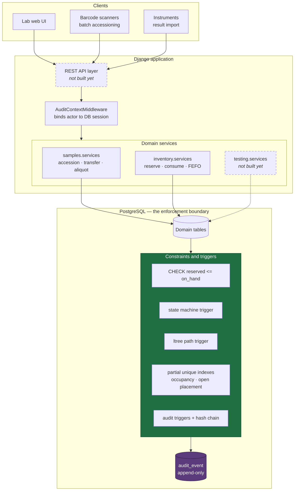
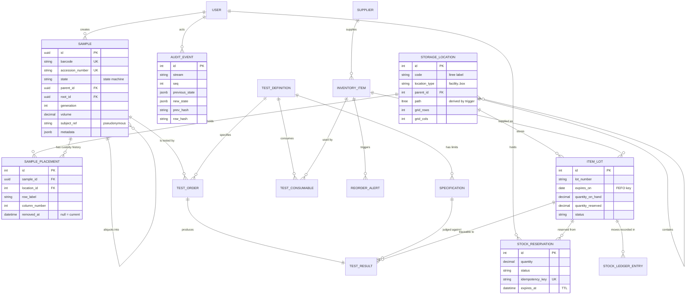
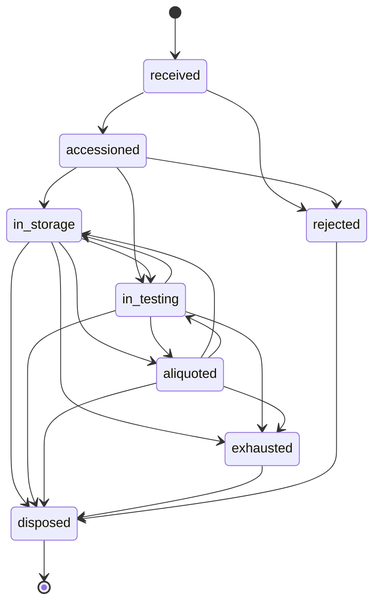

# LIMS — Laboratory Information Management System

A sample-tracking and inventory backend for a regulated laboratory, built
on Django and PostgreSQL.

Two ideas run through the whole design:

**Invariants belong in the database.** Sample lifecycles, stock levels, and
storage occupancy are all enforced by constraints and triggers rather than
by application code. Service functions exist to make the correct path
pleasant and to supply business context the database cannot infer — but if
every line of Python here were wrong, stock still could not go negative and
a disposed sample still could not be resurrected.

**The audit trail covers every writer.** Audit rows are written by database
triggers, not middleware. A `manage.py shell` session, a data migration, or
a DBA in psql produces the same trail as an API call.

---

## Status

| Subsystem | State |
|---|---|
| Storage hierarchy (ltree, N-tier, grid positions) | Implemented + tested |
| Sample lifecycle, lineage, placement | Implemented + tested |
| Batch barcode accessioning (idempotent) | Implemented + tested |
| Inventory: FEFO allocation, reservations, ledger | Implemented + tested |
| Reorder thresholds and alerts | Implemented + tested |
| Audit trail: triggers, hash chain, append-only | Implemented + tested |
| QC testing: definitions, specs, orders, results | **Schema only** — no service layer yet |
| REST API / OpenAPI | **Not built yet** |
| Frontend | **Not built yet** |

64 tests pass against PostgreSQL. Nothing in the table above is claimed
from reading the code — the "tested" rows have tests that fail when the
mechanism is removed.

---

## Setup

Requires Python 3.12+ and PostgreSQL 14+.

```bash
python3.12 -m venv .venv && source .venv/bin/activate
pip install -r requirements.txt
cp .env.example .env          # edit DB_USER / DB_PASSWORD to match your Postgres
createdb lims_dev
python manage.py migrate
python manage.py createsuperuser
python manage.py runserver
```

The `ltree` and `pgcrypto` extensions are created by the first migration,
so no manual database preparation is needed. If your Postgres user cannot
create extensions, run `CREATE EXTENSION` as a superuser first and the
migration will pass through.

To use Docker for the database instead of a local install:

```bash
docker compose up -d db
```

Run the tests:

```bash
python manage.py test --noinput
```

There is deliberately **no SQLite fallback**. The schema depends on ltree,
partial unique indexes, row-level locking, and PL/pgSQL triggers; a SQLite
"convenience mode" would quietly drop every guarantee the system is built
on and pass tests that mean nothing.

---

## Architecture



The green band is the point of the design: those guarantees hold for every
writer, including ones that never touch the Python above them.

### Data model



### Sample lifecycle

Defined once in `ALLOWED_TRANSITIONS` (`apps/samples/models.py`) and
projected into a lookup table the enforcement trigger reads. A test asserts
the two never drift apart.



`aliquoted` is deliberately not terminal — taking an aliquot does not
consume the parent, so it returns to storage or testing. `exhausted` means
volume actually reached zero.

---

## The concurrency story

The interesting question is not "how do you prevent overselling" but
"which layer actually guarantees it." There are three:

1. `SELECT ... FOR UPDATE` on candidate lots — `apps/inventory/services.py`
2. A conditional `UPDATE ... WHERE quantity_on_hand >= quantity_reserved + n`
   — a compare-and-swap, same file
3. `CHECK (quantity_reserved <= quantity_on_hand)` — `apps/inventory/models.py`

**Layers 2 and 3 each prevent overselling on their own.** That was verified
by deletion, not by reasoning: with layer 1 removed, the 50-thread test
still passed; with layers 1 and 2 both removed, Postgres rejected the write
and the test failed with a constraint violation. The database constraint is
the guarantee.

So what is the row lock for? Two things, neither of them correctness:

- **Failure shape.** Without it, losing transactions discover the conflict
  as a failed CAS or a constraint violation mid-transaction. With it, they
  wait, re-read, and get a clean `InsufficientStock` they can act on.
- **Throughput under contention.** Twenty benches booking the same master
  mix at 9am is the normal case. Blocking makes them queue; an optimistic
  scheme would have them all burn a transaction to discover they lost.

This distinction matters because "we use SELECT FOR UPDATE" is the usual
answer and it names the wrong layer. Application locks are only as good as
the code paths that remember to take them. A CHECK constraint has no such
gap.

**On distributed locks.** There is deliberately no Redis lock here. A row
lock lives in the same system as the data, so it cannot disagree with it. A
Redis lease can expire while the Postgres transaction is still open, at
which point two workers both believe they hold it — the failure mode
Kleppmann describes in his Redlock critique, requiring fencing tokens that
row versions already provide. Redis has a place in this architecture as a
read cache and as admission control; it is not a correctness mechanism when
a transactional database is already in the request path.

**On isolation levels.** `READ COMMITTED`, not `SERIALIZABLE`. Once the
rows a transaction depends on are locked `FOR UPDATE`, there is no
read-skew window left for `SERIALIZABLE` to close — it would only add
40001 serialization failures that every caller must retry. The right
isolation level is the weakest one that makes the invariant true.

**Deadlock avoidance.** Multi-lot allocations lock in a single
deterministic order (FEFO: `expires_on NULLS LAST, received_on, id`),
identical for every caller, so contenders always meet on the same row
first.

---

## The audit trail

Every mutation to an audited table writes an `audit_event` row carrying the
actor, timestamp, before/after state, changed columns, reason code, and a
request id correlating everything done in one API call.

Rows are hash-chained: each carries the previous row's hash, so altering or
removing history breaks every hash after it. `SELECT * FROM
audit_verify_chain('sample')` re-walks a stream and returns the first
broken position, or no rows if intact.

Chains are **per table**, not global. One global chain would serialise
every mutation in the system behind a single row lock — every sample move
queued behind every stock decrement.

### What this does and does not guarantee

It is tamper-**evident**, not tamper-**proof**. Someone with UPDATE rights
on `audit_event` who can also run SHA-256 could rewrite the chain forward
and it would verify clean. Closing that requires anchoring chain heads
somewhere the database role cannot reach — append-only object storage (S3
Object Lock) or a separate account, on a schedule.

**That anchoring job is not built.** It is the difference between "an
attacker with database access is detected" and "an attacker with database
access is not detected," and the README says so rather than letting the
phrase "tamper-evident" imply more than the code delivers.

Similarly, `ElectronicSignature` records the components 21 CFR Part 11
describes — signer identity, timestamp, and the *meaning* of the signing —
but it is not a cryptographic digital signature. There is no per-user key
pair, so non-repudiation rests on account control rather than asymmetric
crypto.

### On compliance claims

This system implements technical controls that regulations such as 21 CFR
Part 11 §11.10 describe: an append-only audit trail with attributable
actors, enforced segregation of duties, and record-bound signatures.

That is not the same as being compliant. Compliance is an organisational
process — validation protocols (IQ/OQ/PQ), SOPs, training records, change
control, and an audit — and no schema can confer it. Treat this as software
that would support a compliance effort, not as a compliance claim.

---

## Data protection (India DPDP Act)

`Sample.subject_ref` is a pseudonymous key, never a name or identifier.
Identifiable subject data belongs in a separate, encrypted, access-
controlled store that this system references but does not hold.

The reason is a practical conflict, not a stylistic preference: the DPDP
Act gives data principals erasure rights, while laboratory records carry
retention obligations measured in years. Keeping identity out of the sample
table means honouring an erasure request does not require deleting — or
punching holes in — records that must be retained, and does not break the
append-only audit trail. Erasure removes the resolution of `subject_ref`;
the lab record survives, permanently de-identified.

The separate identity store is **not built** here.

---

## Layout

```
apps/
  accounts/    User model, roles, capability checks
  audit/       Audit models, hash chain, triggers, request context
  storage/     ltree hierarchy, custom ltree field + lookups
  samples/     Lifecycle, lineage, placement, accessioning services
  inventory/   Items, lots, FEFO reservations, ledger, reorder alerts
  testing/     Test definitions, specs, orders, results (schema only)
config/        Settings, URLs, WSGI
```

Migrations worth reading, because they carry the enforcement:

- `storage/0003_ltree_path_triggers.py` — path derivation, cascade on
  re-parent, cycle prevention
- `samples/0002_state_machine_trigger.py` — lifecycle enforcement, seeded
  from the Python definition
- `audit/0002_audit_triggers.py` — the generic audit trigger, chaining,
  append-only enforcement, chain verification

---

## Known limitations

- No REST API yet. Domain services are complete and tested; the HTTP layer
  on top of them is not written.
- The QC testing subsystem has a schema but no service layer — no result
  entry, review, or approval flow yet, though the segregation-of-duties
  constraints are already in the database.
- Audit chain heads are not anchored externally (see above).
- No per-user signing keys for electronic signatures.
- The reservation sweeper (`services.sweep_expired`) has no scheduler
  wired up; it needs a cron or Celery beat entry to actually run.
- Sample `metadata` is unvalidated JSONB. Fine for lab-specific fields,
  but anything queried often should be promoted to a real column.

See [docs/architecture-decisions.md](docs/architecture-decisions.md) for
the reasoning behind the storage model, locking strategy, and audit design,
including the options that were rejected.
